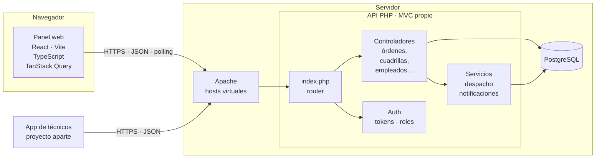
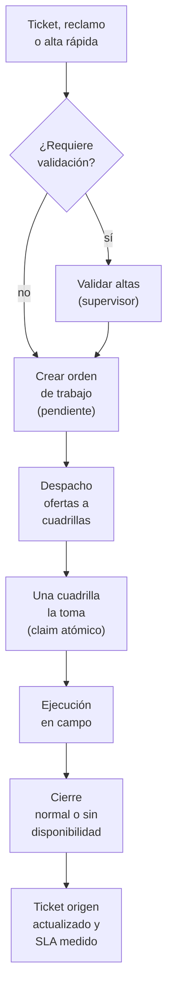
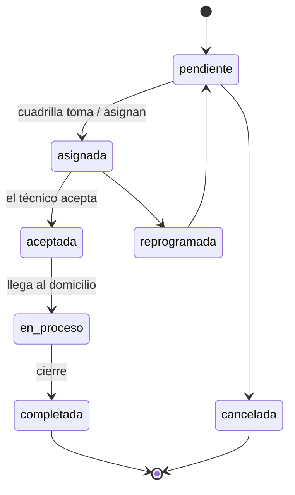
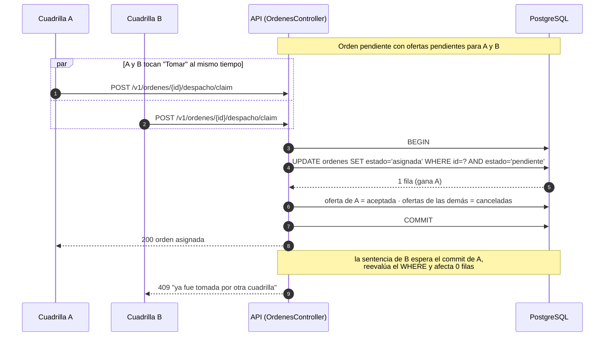
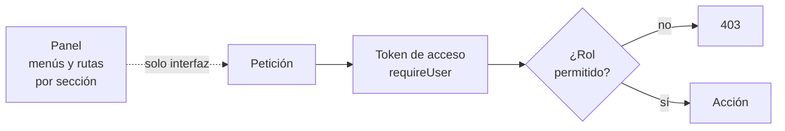
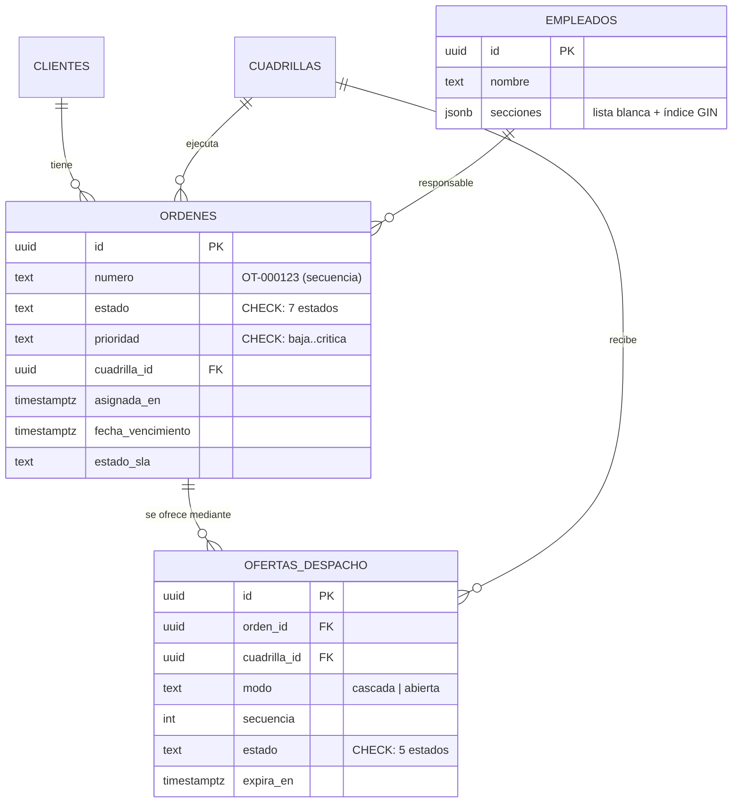

# Arquitectura

Field Dispatch es una plataforma de gestión de servicio técnico para un ISP (en esta demo, el ficticio **Acme ISP**). Convierte reclamos y pedidos en **órdenes de trabajo (OT)**, las despacha a **cuadrillas** y permite seguirlas hasta el cierre.

> Esta documentación describe un diseño simplificado, basado en mi experiencia. Los nombres, los datos y los identificadores son ficticios.

## 1. Vista general

- **Panel web**: aplicación de una sola página. Se compila a archivos estáticos que sirve Apache.
- **API**: un front controller (`public/index.php`) registra las rutas `/v1/...` y delega en controladores. Las clases de apoyo (`Request`, `Response`, `Validator`, `Database`, `Auth`) mantienen consistentes la validación, el formato de error y el acceso a datos con PDO.
- **PostgreSQL**: única fuente de verdad. Los invariantes importantes viven en la base (restricciones `CHECK`, índices únicos parciales), no solo en el código.
- **App de técnicos**: cliente móvil de la misma API, documentado en su propio repositorio.

## 2. Del ticket a la orden de trabajo

## 3. Estados de una orden

Los estados permitidos están garantizados por una restricción `CHECK` en la base. El diagrama muestra el camino principal; `cancelada` y `reprogramada` pueden darse antes de la ejecución.

La orden tiene una marca de tiempo por cada hito (`asignada_en`, `aceptada_en`, `llegada_en`, `completada_en`, `cancelada_en`), lo que permite medir tiempos de respuesta y de ejecución. El vencimiento (`fecha_vencimiento`) y `estado_sla` soportan el seguimiento de SLA.

## 4. Despacho: ofertas a cuadrillas

Cada orden se ofrece a una o más cuadrillas mediante filas en `ofertas_despacho`. El modelo de datos distingue dos modos:

| Modo | Idea | Columnas que lo sostienen |
|------|------|---------------------------|
| `cascada` | La oferta pasa de una cuadrilla a otra en orden, con vencimiento por oferta | `secuencia`, `distancia_metros`, `expira_en` |
| `abierta` | Se ofrece a varias cuadrillas a la vez; gana la primera que la toma | varias ofertas `pendiente` para la misma orden |

Cada oferta termina en `aceptada`, `rechazada`, `expirada` o `cancelada`.

El detalle de por qué esto es seguro y cómo se prueba está en [`examples/atomic-claim`](../examples/atomic-claim) y en [la decisión 2](decisions.md#2-claim-atómico-con-update-condicional-en-lugar-de-select--for-update).

## 5. Seguridad y acceso

Hay dos capas, con responsabilidades distintas:

- **API**: autenticación por token de acceso/refresco y autorización por **rol**.
- **Panel**: además filtra menús y rutas por las **secciones** habilitadas para cada empleado (lista configurable por un administrador).
- **Brecha conocida**: las secciones se aplican hoy en la interfaz, no en el servidor. El ejemplo [`section-permissions`](../examples/section-permissions) muestra un guard del lado servidor, propuesto como refuerzo. Ver [decisión 3](decisions.md#3-permisos-por-sección-en-la-interfaz-con-refuerzo-propuesto-en-el-servidor).

## 6. Modelo de datos (extracto)

Detalles de diseño en la base:

- Claves primarias `uuid` (`gen_random_uuid()`), con un `numero` legible por humanos generado desde una secuencia (`OT-000123`).
- `CHECK` en estados, prioridades y tipo de cierre: un valor inválido no entra aunque falle la validación de la aplicación.
- Índice único parcial `(orden_id, cuadrilla_id) WHERE estado = 'pendiente'`: no puede haber dos ofertas vivas de la misma orden para la misma cuadrilla.
- Índice único parcial sobre `ticket_externo_id` (solo cuando no es nulo): una orden por ticket externo.
- `secciones` como `jsonb` con índice GIN.

## 7. Refresco de datos en el panel

El panel consulta la API a intervalos con TanStack Query (`refetchInterval`), no usa WebSocket. Los intervalos van de 10 s (una orden recién creada sin cuadrilla) a 60 s (notificaciones), con 30 s para listados y dashboard. Ver [decisión 1](decisions.md#1-polling-en-lugar-de-websocket).
